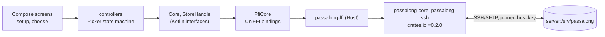

# passalong-android

The Android client for [passalong](https://github.com/joelee/passalong), a
lightweight, cross-platform clipboard and file sharing tool. One machine
you already own runs a plain SSH server with a storage directory; every
other device pushes and pulls items there. No cloud service, no account.

**Status:** pre-release. The first milestone is what the TUI's
`passalong choose` does, an item picker over your store, plus the in-app
setup that replaces `passalong init` on a phone.



The app reuses the Rust core through a UniFFI bridge, so host-key
pinning, the item schema, SHA-256 verification, deduplication, the list
cache, and encrypted stores behave exactly like the CLI.

## What it does

- **Setup** (`passalong init`): the app makes this device an ed25519 key
  and shows the public key to add to the server's `authorized_keys`; you
  enter the server, it fetches the host key, and you confirm the
  fingerprint before the key is pinned. Nothing is written until you do.
- **Choose** (`passalong choose`): the stored items, newest first, from
  the list cache when it is fresh (the bottom line says `cached 30 s ago`)
  or from the server. Filter by id, name or preview, device, or kind. Tap
  to load: text goes to the clipboard, files and clipboard images to
  Downloads, checked against their SHA-256 first. Long press to show the
  content, the metadata as `passalong get` prints it, or to delete after
  confirming. Reload from the cache (`r`) or the server (`R`), and `?` for
  help, from the menu.

See [docs/usage.md](docs/usage.md) for the screens,
[docs/configuration.md](docs/configuration.md) for where the app keeps
what, and [docs/architecture.md](docs/architecture.md) for how it is put
together.

## Development

Requires JDK 21 and Gradle 8.14.3 (pinned in `.mise.toml` for
[mise](https://mise.jdx.dev)), the Android SDK with an NDK, a Rust
toolchain with the Android targets, `cargo-ndk`, and
[`just`](https://github.com/casey/just). See
[docs/developer-guide.md](docs/developer-guide.md) for one-time setup.

```sh
just setup        # once: mise install, rustup targets, cargo-ndk
just check        # fmt-check, lint, test, coverage, build
just install      # the debug APK onto a connected device
```

## License

Licensed under the [Apache License, Version 2.0](LICENSE). See
[NOTICE](NOTICE) for third-party material.
